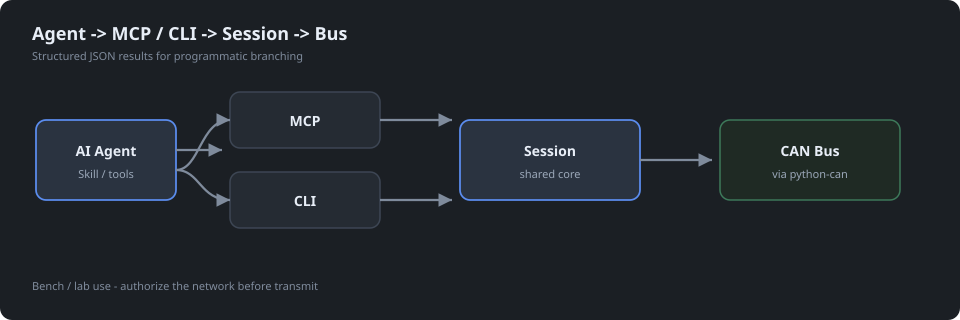
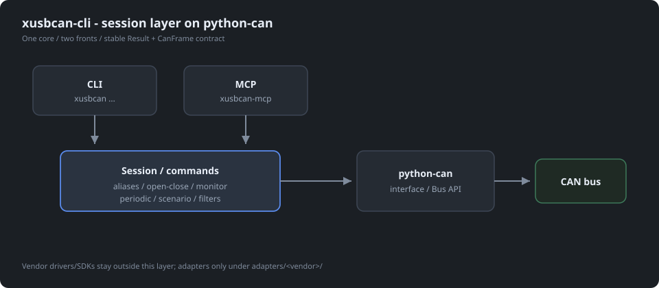
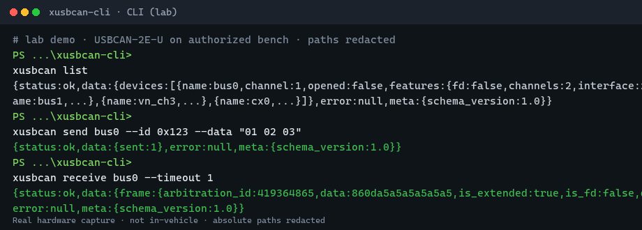
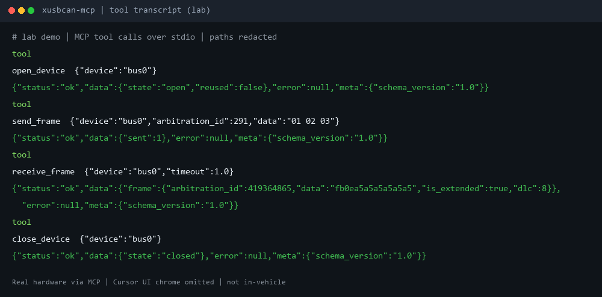

# xusbcan-cli

面向 AI Agent 的多厂商 CAN 总线调试工具。

以后端服务形态运行，同时提供标准 **CLI** 与 **MCP（Model Context Protocol）** 接口，让 AI Agent 能直接完成 CAN 报文的收发、监听、周期发送等调试操作——无需人工操作上位机软件，即可实现 **Agent 自动化联合调试**。

[](LICENSE)
[](https://www.python.org/)
[](https://pypi.org/project/xusbcan-cli/)
[](https://deepwiki.com/Archaofan/xusbcan-cli)

<!-- mcp-name: io.github.Archaofan/xusbcan -->

中文 | [English](README.en.md)

国内镜像：[Gitee](https://gitee.com/carson0323/xusbcan-cli)（以 GitHub 为准同步）

## 目标与展望

在 AI 时代，让 Agent 能像使用普通工具一样操作 CAN 总线：结构化输出、稳定契约、可被程序化调用。

我们的**目标**是让 xusbcan-cli 成为 AI 与车载 / 工业 CAN 总线之间的可靠桥梁，使「用 Agent 自动完成台架上的联调、诊断、验证」更常见。本项目以 [python-can](https://github.com/hardbyte/python-can) 为底座，在其上提供统一命令与会话。当前仍是早期版本：先把已确认的厂商与型号跑通，再按型号扩展，而不是宣称已经覆盖所有厂商或成为行业标准。

## 特性

- **同一套命令**：CLI / MCP 命令名不随厂商变化；驱动、环境变量与配置随卡变化
- **CLI 与 MCP 同源**：结构化 JSON 输出，便于 Agent 分支处理
- **python-can 优先**：已有后端可直接写 `interface`；需要通道映射或专有参数时再登记型号
- **可安装 Agent Skill**：先确认型号，再调用；厂商踩坑按型号分文件



## 会话层做什么

本项目在 python-can（或自研后端给出的 `can.Bus`）之上提供**统一会话与命令层**，而不是再实现一套总线协议栈。大致包括：



- **配置与别名**：`xusbcan.toml` 里用逻辑名引用设备，打开参数集中管理
- **会话生命周期**：按别名 `open` / `close`，多卡并存；关闭时收回周期任务与有界监听
- **统一结果契约**：`Result` + `error.code` 枚举，超时收帧等可程序化分支（不必解析人类日志）
- **常用调试原语**：有界 `monitor`、带时长的周期发送、ID 范围滤波、毫秒级 `scenario` 编排
- **双入口同源**：同一套 core 同时服务 CLI 与 MCP，避免「脚本一套、Agent 又一套」
- **应用层预算**：周期发送 / Scenario 的时长与发送次数等限制（非硬件失效保护）

底层怎么打开卡，仍由对应 `interface` 或本仓库登记的后端决定。

### 相对「已经直接用 python-can + AI」的意义

若团队已经让 Agent 写临时 `can.Bus` 脚本调卡，本项目**不替代** python-can，而是补一层**可复用的工具契约**：

| 直接 python-can + AI | 使用本项目 |
|----------------------|------------|
| 每次由模型拼后端参数与样板代码 | 配置一次，用稳定 CLI / MCP 工具名调用 |
| 输出形状随提示词变化 | 固定 JSON / `error.code`，便于 Agent 分支 |
| 会话、周期、监听、编排各自手写 | 会话层与 `scenario` 已提供 |
| 型号踩坑靠聊天上下文 | Skill 按型号分文件，先确认再调用 |
| python-can 没有的卡需自写封装 | 本仓库可提供/登记后端（如部分国产卡） |

已经精通 python-can、且只想本机写死脚本时，不必强行迁移。面向 **Agent 联调、多卡别名、MCP 工具化、结构化结果** 时，本项目更省事。安装本项目**不会**拦截或屏蔽 python-can 其它后端。

## 安装

```bash
pip install xusbcan-cli        # CLI + 核心
pip install xusbcan-cli[mcp]   # 追加 MCP
```

从源码：

```bash
git clone https://github.com/Archaofan/xusbcan-cli.git
cd xusbcan-cli
pip install -e ".[mcp]"
```

## 快速开始

1. 确认手上的**厂商与型号**，安装该卡要求的驱动 / SDK  
2. 编写 `xusbcan.toml`（或设置 `XUSBCAN_CONFIG`）  
3. 用别名调用 CLI / MCP  

### 通用配置

```toml
[[devices]]
name = "bus0"
interface = "socketcan"   # 任意 python-can 已声明的后端名
channel = "can0"
nominal = 500000
# data = 2000000          # 可选，CAN FD 数据段
```

- Python 3.11+（64 位）
- `name` 为逻辑别名；命令与 MCP 都用它
- 写了 `interface` 时按该后端打开；`vendor` / `model` 用于需要快捷映射的型号
- MCP 默认 stdio；`http` 仅绑定 `127.0.0.1`

### CLI

```bash
xusbcan list
xusbcan send bus0 --id 0x123 --data "01 02 03"
xusbcan receive bus0 --timeout 1
xusbcan monitor bus0 --duration 5
xusbcan status bus0
xusbcan receive bus0 --timeout 1 --from-id 0x100 --to-id 0x1FF
xusbcan periodic bus0 --name hb --id 0x123 --data "01" --period 0.1 --duration 5
xusbcan scenario --file steps.json
xusbcan scenario --dir scenarios/
```



*台架 / lab 演示（路径已脱敏；非实车）*

`periodic` 在本进程发满 `--duration` 后停止。`scenario` 在同进程编排发→等→再发；`--dir` 按文件名批跑。跨多次调用保持会话时用 MCP。

### MCP

```bash
xusbcan-mcp
```

Agent 使用 `open_device`、`send_frame`、`receive_frame`、`monitor`、`periodic_start` 等工具。`periodic_start` **必须**带 `duration_s`（上限 300 秒）。更长任务请用本机常驻进程，并明确授权台架环境。



*台架 / lab 演示：MCP 工具调用成绩单（配置路径已脱敏；非 Cursor UI 截图；非实车）*

注册时按所用适配器设置对应环境变量与 `XUSBCAN_CONFIG`（见下方各厂商小节）。

## 适配器准备

按厂商阅读对应小节。每家使用**自己的**驱动与环境变量；配置里写明该卡的 `vendor` / `model` 或 `interface`。

### 周立功（ZLG）

适用于已确认的 **USBCAN-2E-U**、**USBCAN-II**。

需要：

- 周立功 USB 驱动
- 二次开发 SDK（`zlgcan.dll` 与同目录 `kerneldlls/`）
- `ZLG_SDK_DIR` 指向该 SDK 目录

资料：https://manual.zlg.cn/web/#/152?page_id=5332

```bash
# 当前终端
set ZLG_SDK_DIR=D:\path\to\zlg-sdk-dir
```

```toml
[[devices]]
name = "bus0"
vendor = "zlg"
model = "USBCAN-2E-U"   # 或 "USBCAN-II"
channel = 1             # 按实际接线：CAN1→0，CAN2→1
nominal = 250000
```

2E-U / II 均为双通道，`channel` 必须对应实际接线口。型号以铭牌与配置 `model` 为准；不要根据 SDK `GetDeviceInf` 一类字段改判型号或改走 CAN FD。滤波与周期发送路径因型号而异，见 Agent Skill 对应参考页。

```json
{
  "mcpServers": {
    "xusbcan": {
      "command": "xusbcan-mcp",
      "env": {
        "ZLG_SDK_DIR": "D:\\path\\to\\zlg-sdk-dir",
        "XUSBCAN_CONFIG": "D:\\path\\to\\xusbcan.toml"
      }
    }
  }
}
```

### Vector

适用于已确认的 **VN1640A**（**VN1630** 已登记，本仓库未做真机确认）。

需要：

- Vector 驱动 / XL Driver（从官方渠道取得授权）
- `channel` 使用与 python-can / XL Driver **相同的全局通道索引**（无逻辑重映射）。硬件 Channel *N* 通常对应索引 `N - 1`，以本机枚举为准

打开时交给 **python-can 已有的 `vector` 后端**。本仓库**不**封装 XL Driver ABI，只提供型号快捷方式（通道数、`app_name=None` 等）以及 CLI / MCP / Skill 的统一用法与真机说明。

```toml
[[devices]]
name = "vn0"
vendor = "vector"
model = "VN1640A"
channel = 2
nominal = 250000
# data = 2000000    # 该通道支持 CAN FD 时可选
```

也可直接写 `interface = "vector"`。

```json
{
  "mcpServers": {
    "xusbcan": {
      "command": "xusbcan-mcp",
      "env": {
        "XUSBCAN_CONFIG": "D:\\path\\to\\xusbcan.toml"
      }
    }
  }
}
```

### 创芯（Chuangxin）

适用于已确认的 **USB_CAN-2C**（**USB_CAN-2A-GD** 已登记为同后端族，**真机验证暂挂起**，勿标为已确认）。

需要：

- 创芯 USB 驱动
- 与 Python 位数匹配的 `ControlCAN.dll`
- `CHUANGXIN_SDK_DIR` 指向含该 DLL 的目录（本工具按绝对路径加载）

```bash
set CHUANGXIN_SDK_DIR=D:\path\to\chuangxin-controlcan-dir
```

```toml
[[devices]]
name = "cx0"
vendor = "chuangxin"
model = "USB_CAN-2C"
channel = 0
nominal = 250000
```

同一进程中请只加载一份你选用的 `ControlCAN.dll`；若其它软件也依赖各自的同名 DLL，请分目录或分进程使用。

```json
{
  "mcpServers": {
    "xusbcan": {
      "command": "xusbcan-mcp",
      "env": {
        "CHUANGXIN_SDK_DIR": "D:\\path\\to\\chuangxin-controlcan-dir",
        "XUSBCAN_CONFIG": "D:\\path\\to\\xusbcan.toml"
      }
    }
  }
}
```

### 其它后端（python-can 直通）

以 Vector 等型号为证：**python-can 已有后端 + 本项目会话层** 这条路径已经走通。因此，凡在当前环境中 python-can 已声明且本机能打开的后端（如 socketcan、slcan、Kvaser、`pcan` 等），**大概率**只需配置 `interface` / `channel` / `extra` 即可用同一套 CLI / MCP；**不保证**每张卡都已在本仓库真机确认，驱动安装、通道写法、FD/滤波/无 ACK 等行为仍随后端而异，可能踩坑。

本仓库对 **PEAK PCAN-USB** 另有型号登记（通道映射），状态为「已登记，未在本仓库真机确认」。写了 `interface` 时不会改走别的后端，也不会阻止你继续在别的程序里直接使用 python-can。

## 支持范围

| 厂商 | 型号 | 状态 | 说明 |
|------|------|------|------|
| 周立功 | USBCAN-2E-U | 真机已确认 | 本仓库 `zlg` 后端；需 `ZLG_SDK_DIR` |
| 周立功 | USBCAN-II | 真机已确认 | 同上，按型号分发 |
| Vector | VN1640A | 真机已确认 | python-can `vector`；通道为 XL 全局索引 |
| Vector | VN1630 | 已登记 | python-can `vector` |
| 创芯 | USB_CAN-2C | 真机已确认 | 本仓库 ControlCAN 后端；需 `CHUANGXIN_SDK_DIR` |
| 创芯 | USB_CAN-2A-GD | 已登记（真机验证挂起） | 与 2C 同后端族；验证暂挂起 |
| PEAK | PCAN-USB | 已登记 | python-can `pcan` |

上表是带登记或真机说明的型号，不是准入白名单。其它 python-can 后端见上文「其它后端（python-can 直通）」：可打开 ≠ 本仓库已逐型号真机确认。python-can 无法打开的卡才需要新后端；若新后端要求用户自备 SDK，请在免责声明中追加该厂商。

### 真机验证说明

「真机已确认」表示：在**已获授权的台架**上，对本仓库公开的 CLI / 核心路径做过有限验证（打开与重开、收发、滤波、多开、`monitor` / `periodic`、`scenario` 等，视该型号当时测试范围而定）。

**该说明适用于本仓库标为真机已确认的全部型号**：验证仅覆盖对应测试台架与当时范围，**不构成**对任一厂商产品的性能、兼容性或适销性担保，也不保证每一台设备、每一种子卡 / 主机环境均已覆盖。未覆盖项通常包括主动构造错误帧、长时间 soak、实车网络等。细节与踩坑见 Agent Skill 中该型号参考页。

## Agent Skill

```bash
npx skills add Archaofan/xusbcan-cli --skill xusbcan
```

在项目目录执行可装到当前工程；`-g` 装到用户目录；`-a` 指定客户端（如 `cursor`）。Skill 先读通用契约，再按 `references/catalog.md` 只打开当前配置对应的型号页，避免把全部厂商知识塞进上下文。

## 参与

欢迎报告问题、提交 PR、贡献新的厂商或型号登记。公开约定摘要如下（细节见 [`CLAUDE.md`](CLAUDE.md)、[`skills/xusbcan/`](skills/xusbcan/)、[`third_party/ABI_PROVENANCE.md`](third_party/ABI_PROVENANCE.md)）：

- **去耦合**：厂商差异只进 `src/xusbcan/adapters/<厂商>/`；`core` / `cli` / `mcp` 不出现厂商概念，只调用 python-can 通用接口（如 `set_filters` / `send_periodic`）。适配器可在后端钩子内使用厂商专有 API。配置里已有 `interface` 即可打开，不必先为每个型号改会话层。
- **可持续扩展**：python-can 已有后端 → 只加 `profiles.py`（及可选型号快捷方式）；没有后端才加自研绑定并注册 `can.interface`。新增卡时改适配层 + Skill 的 `references/catalog.md` 一行 + 一份型号页；**不要**把各型号症状写进 Skill 根 `description`，也**不要**把全部厂商页塞进一次上下文。
- **Skill 契约**：根页写通用怎么用；型号页顺序为 Quick start → How this backend behaves → Field notes。Field notes 须标明是前人台架/开发中的现场报告，**未必可复现**，不作正式「不支持」清单，也不据此断言整型号缺陷。
- **真机与公开表述**：通用配置与该型号的驱动 / 环境变量分开写；真机确认前不要标成「已验证」。需用户自备 SDK 的新厂商，在 README 免责声明追加一条商标与交付边界。
- **合规**：不提交厂商 DLL / SDK 原文、本机绝对路径、客户/ECU 名等；提交前按 `CLAUDE.md` 脱敏清单自检。

## 安全使用

- 仅在**已获授权的台架 / 实验室**使用；不要在实车控制网或未授权产线上让 Agent 无人值守发报文
- 发送与周期发送前确认接线、波特率与 ID；长时任务请设明确时长或改用本机常驻进程
- MCP 默认本机使用；HTTP 仅 `127.0.0.1`，勿暴露公网
- **应用层预算（非硬件失效保护）**：MCP / Scenario 周期发送须带时长（上限 300 秒）；Scenario 另有墙钟、单步与累计发送次数等限制。周期停止或关闭失败时返回结构化错误并尽量保留可查询任务/会话，便于重试——这不等于硬件失效保护，驱动或硬件异常时仍不能保证一定停止发送

## 免责声明

本项目是独立的第三方工具，与下列厂商及其产品没有关联、赞助、背书或利益关系。厂商名称、产品名称均为其各自权利人的商标。驱动与 SDK 的版权归权利人所有，由使用者从官方渠道自行获取。

本项目按 MIT 提供**自有代码**，不提供任何担保。`python-can` 等依赖与用户自备 SDK 各有其许可，详见 [`third_party/NOTICES`](third_party/NOTICES)。

**真机确认仅覆盖上文「真机验证说明」中的台架范围，不构成对任何已确认型号的性能、兼容性或适销性担保。**

每支持一家需要使用者自备 SDK 或专有驱动的厂商，在此追加商标与交付边界说明：

- **广州致远电子股份有限公司（周立功 / ZLG）**：经公开二次开发接口对接的型号包括 USBCAN-2E-U、USBCAN-II。"周立功"、"ZLG"、"zlgcan" 等为其商标。本项目不随附其驱动或 `zlgcan.dll`。
- **Vector Informatik GmbH（Vector）**：经 python-can `vector` 打开的型号包括 VN1640A。"Vector"、"VN1640A"、"XL Driver" 等为其商标。本项目不随附 Vector 驱动、XL Driver、CANoe/CANalyzer 或其它专有软件。
- **珠海创芯科技有限公司（创芯）**：经本仓库 ControlCAN（`VCI_*`）薄封装打开的型号包括 USB_CAN-2C。"创芯"、"USB_CAN-2C"、"CANalyst" 等为其商标。本项目不随附创芯驱动或 `ControlCAN.dll`。

## License

[MIT License](LICENSE)。第三方条款见 [`third_party/NOTICES`](third_party/NOTICES)。各厂商是「自研 ctypes 后端」还是「仅 python-can 快捷方式」，见 [`third_party/ABI_PROVENANCE.md`](third_party/ABI_PROVENANCE.md)。
